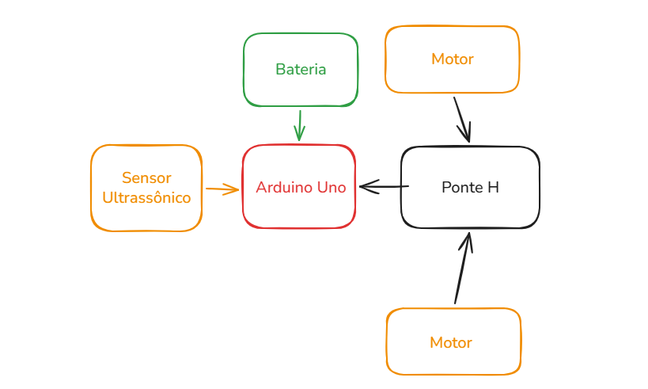
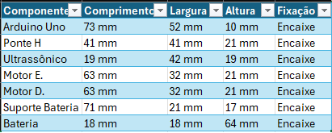

# RoboMaker — Carrinho robótico com ESP32, controle BLE e TinyML (Edge Impulse)

**Integrantes:** Vinícius Bernardino - RM 97888 · Gabriel Pacheco - RM 550191

---

## Sumário

1. [Evolução CP1 → CP2](#1-evolução-cp1--cp2)
2. [Visão geral e arquitetura](#2-visão-geral-e-arquitetura)
3. [Hardware](#3-hardware)
4. [Estrutura do repositório](#4-estrutura-do-repositório)
5. [Firmware do ESP32](#5-firmware-do-esp32)
6. [Dataset e coleta de dados](#6-dataset-e-coleta-de-dados)
7. [Projeto no Edge Impulse](#7-projeto-no-edge-impulse)
8. [Integração do modelo com o ESP32](#8-integração-do-modelo-com-o-esp32)
9. [Como reproduzir](#9-como-reproduzir)
10. [Estado atual e problemas conhecidos](#10-estado-atual-e-problemas-conhecidos)
11. [Gestão do projeto (CP1)](#11-gestão-do-projeto-cp1)
12. [Referências](#12-referências)

---

## 1. Evolução CP1 → CP2

O histórico de commits mostra a evolução. Os arquivos do CP1 são **mantidos**, e o CP2 é acrescentado por cima, em novos commits.

### O que mudou de um checkpoint para o outro

| Aspecto | CP1 (planejamento) | CP2 (implementação + TinyML) |
|---|---|---|
| Microcontrolador | Arduino Uno | **ESP32 DevKit V1** |
| Comunicação | Módulo Bluetooth HC-05/HC-06 | **BLE nativo do ESP32** (app Bluefruit Connect, iPhone) |
| Alimentação | Bateria 7,4 V | 2× 18650 em série (7,4 V), 5 V para o ESP32 vindo do L298N |
| Montagem | Previa protoboard (imagens de referência) | **Sem protoboard**, tudo ligado direto com jumpers |
| Inteligência | Parada por limite de distância | Limite de distância **+ modelo TinyML** (Edge Impulse) |
| Entregas | Backlog, Kanban, MoSCoW, MVP, medidas, diagrama | Firmware, coleta de dados, dataset, projeto Edge Impulse, integração |

O motivo da troca Arduino Uno → ESP32: o Uno tem apenas 2 KB de RAM, o que inviabiliza rodar um modelo TinyML. O ESP32 tem BLE integrado e memória suficiente.

### Histórico de commits

**CP1** (já existentes, não alterados):

| Commit | Data | Conteúdo |
|---|---|---|
| `4ac0410` | 25/08/2026 | Initial commit |
| `0690792` | 25/08/2026 | Documentação inicial (upload) |
| `57b4584` | 27/08/2026 | Documentação (upload) |
| `d9768fb` | 31/08/2026 | Documentação (upload) |

**CP2, já registrados no repositório** (os commits de upload têm a mensagem automática do GitHub, por isso o conteúdo de cada um está descrito):

| Commit | Data | Conteúdo |
|---|---|---|
| `1e2a8ca` | 16/10/2026 | README do projeto (primeira versão do CP2) |
| `50cc539` | 16/10/2026 | Firmware: `carrinho_ble.ino`, `teste_motores.ino`, `teste_sensor.ino` |
| `c68e531`, `f974a19` | 16/10/2026 | Ajustes e limpeza de comentários do `carrinho_ble.ino` |
| `1af60dc` | 16/10/2026 | Ajuste do `teste_sensor.ino` |
| `b249d72` | 16/10/2026 | README: identificação dos integrantes |
| `4fd194a` | 28/10/2026 | **Dataset:** 15 CSVs coletados, em `dados/` |
| `68bd159` | 28/10/2026 | **TinyML:** `07_carrinho_tinyml.ino` (carrinho com o modelo) |
| `e6393b7` | 28/10/2026 | **Evidência do Edge Impulse:** print do bloco de processamento (`img/image.png`) |

**CP2, etapas ainda por registrar** (um commit por etapa, **sem sobrescrever o CP1**):

| Mensagem sugerida | O que entra |
|---|---|
| `CP2: firmware e script de coleta de dados` | `04_coleta_dados.ino` e `coletar_csv.py` |
| `CP2: diagnóstico dos motores` | `05_diagnostico_motores.ino` |
| `CP2: biblioteca Edge Impulse (Arduino library)` | `edge-impulse/ei-vinicius_bernardino-project-1-arduino-1.0.2-impulse-1.zip` |
| `CP2: teste de inferência no ESP32` | `06_inferencia_ei.ino` |
| `CP2: evidências do Edge Impulse e do ESP32` | prints do Studio e do Monitor Serial em `img/` |
| `CP2: README final com métricas` | este arquivo, com os `[PREENCHER]` resolvidos |

Cada etapa é registrada com `git add`, `git commit` e `git push`, nunca com `push --force`.

---

## 2. Visão geral e arquitetura

Funcionalidades:

- Movimentos: frente, ré, esquerda, direita e parada.
- Controle pelo iPhone via BLE (Bluefruit Connect, aba *Controller → Control Pad*).
- Parada automática diante de obstáculo, com histerese (bloqueia a 20 cm e só libera a 25 cm).
- Ajuste de velocidade pelo app, com partida suave (rampa de PWM).
- **CP2:** classificação da situação à frente por um modelo TinyML rodando no ESP32, usada para decidir o movimento no modo automático.

Fluxo de dados completo:

```text
HC-SR04 ──► ESP32 ──► (04_coleta_dados) ──► USB ──► coletar_csv.py ──► CSVs ──► Edge Impulse
                                                                                   │
                                                                    treino + biblioteca Arduino (.zip)
                                                                                   │
HC-SR04 ──► ESP32 ──► janela de 10 leituras ──► modelo TinyML ──► classe ──► decisão ──► L298N ──► motores
                ▲
   iPhone (BLE) ┘
```

Diagrama de blocos original do CP1 (Arduino Uno, antes da troca para ESP32):



---

## 3. Hardware

### Componentes

| Componente | Função |
|---|---|
| ESP32 DevKit V1 | Microcontrolador, BLE e inferência TinyML |
| Driver de motor L298N (ponte H) | Aciona os dois motores DC |
| Kit de chassi acrílico 2WD | 2 motores com caixa de redução, 2 rodas, roda boba |
| Sensor ultrassônico HC-SR04 | Mede a distância até o obstáculo |
| 2× bateria 18650 + suporte | Alimentação (7,4 V nominais) |
| Jumpers (F-F, M-F, M-M) | Todas as ligações, sem protoboard |

Dimensões usadas no planejamento do CP1:



### Pinagem do ESP32

| Sinal | Pino do ESP32 | Destino | Observação |
|---|---|---|---|
| ENA | GPIO 25 | L298N ENA | PWM, velocidade do motor esquerdo (capinha removida) |
| IN1 | GPIO 26 | L298N IN1 | Direção do motor esquerdo |
| IN2 | GPIO 27 | L298N IN2 | Direção do motor esquerdo |
| IN3 | GPIO 14 | L298N IN3 | Direção do motor direito (dá um pulso curto ao ligar) |
| IN4 | GPIO 13 | L298N IN4 | Direção do motor direito |
| ENB | GPIO 33 | L298N ENB | PWM, velocidade do motor direito (capinha removida) |
| TRIG | GPIO 18 | HC-SR04 TRIG | Disparo da medição |
| ECHO | GPIO 19 | HC-SR04 ECHO | Retorno do eco |
| LED | GPIO 2 | LED azul da placa | Indicador de estado (não há LEDs externos) |

### Alimentação

| De | Para |
|---|---|
| Bateria + (7 a 12 V) | L298N, borne **12V** |
| Bateria − | L298N, borne **GND** |
| L298N, borne **5V** | ESP32, pino **VIN** |
| L298N, borne **GND** | ESP32, pino **GND** (GND comum) |
| L298N OUT1 / OUT2 | Motor A (esquerdo no código) |
| L298N OUT3 / OUT4 | Motor B (direito no código) |
| HC-SR04 VCC / GND | ESP32 **3V3** / **GND** |

Cuidados:

- Os pinos do ESP32 trabalham em 3,3 V e **não toleram 5 V**. Por isso o HC-SR04 foi alimentado com 3,3 V (o ECHO pode ir direto ao GPIO). A alternativa é alimentar com 5 V e usar divisor de tensão (1 kΩ e 2 kΩ) no ECHO.
- Nunca ligar o cabo USB e a alimentação pelo pino VIN ao mesmo tempo. Nos testes com USB, o fio 5V → VIN fica desconectado.
- O jumper do 5V-EN do L298N foi mantido (o regulador do L298N gera os 5 V para o ESP32).

---

## 4. Estrutura do repositório

Estrutura atual do repositório. Os itens marcados com **(a adicionar)** existem no projeto, mas ainda não foram enviados ao GitHub.

```text
RoboMaker/
├── README.md
├── carrinho_ble.ino                  controle BLE + parada por obstáculo
├── teste_motores.ino                 teste dos motores
├── teste_sensor.ino                  teste do HC-SR04
├── 07_carrinho_tinyml.ino            carrinho com o modelo TinyML no modo automático
├── 04_coleta_dados.ino               (a adicionar) firmware de coleta de dados
├── coletar_csv.py                    (a adicionar) programa de captura dos CSVs
├── 05_diagnostico_motores.ino        (a adicionar) diagnóstico dos motores
├── 06_inferencia_ei.ino              (a adicionar) teste da inferência, sem motores
├── dados/                            15 CSVs coletados, um por captura
│   ├── afastando.001.csv ... afastando.003.csv
│   ├── aproximando.001.csv ... aproximando.003.csv
│   ├── livre.001.csv ... livre.006.csv
│   └── parado_perto.001.csv ... parado_perto.003.csv
├── edge-impulse/                     (a adicionar) biblioteca Arduino exportada (.zip)
├── Docum/                            planejamento do CP1
│   ├── # Backlog Robô Maker.md
│   ├── # Kanban Robô Maker.md
│   ├── MoSCoW.pdf
│   └── MVP Projeto Robô Maker.pdf
└── img/
    ├── DiagramaBlocos.png            (CP1)
    ├── Medidas.png                   (CP1)
    ├── Referencia.png                (CP1)
    └── image.png                     print do Edge Impulse: bloco Flatten (CP2)
```

> No Arduino IDE, cada `.ino` precisa estar numa pasta com o mesmo nome do arquivo. Ao baixar o projeto, crie uma pasta por sketch (por exemplo, `carrinho_ble/carrinho_ble.ino`).

---

## 5. Firmware do ESP32

| Arquivo | Para que serve | No repositório |
|---|---|---|
| `teste_motores.ino` | Sequência de 8 passos (frente, ré, curvas, giros) com 2 s cada, para validar motores e fiação. Usa PWM nos pinos ENA/ENB. | Sim |
| `carrinho_ble.ino` | Servidor BLE (Nordic UART) que entende o protocolo do Control Pad do Bluefruit Connect, controla os motores com rampa de velocidade e bloqueia o avanço diante de obstáculo. Tem modo automático por regra simples (sensor desligado por padrão). | Sim |
| `teste_sensor.ino` | Lê o HC-SR04 e imprime a distância no Monitor Serial. | Sim |
| `04_coleta_dados.ino` | Lê o HC-SR04 a 10 Hz e imprime `timestamp,distancia_cm` pela USB. Mantém os motores parados. Foi usado na coleta. | A adicionar |
| `05_diagnostico_motores.ino` | Teste liga/desliga sem PWM, para separar problema de fiação de problema de código. | A adicionar |
| `06_inferencia_ei.ino` | Lê o sensor a 10 Hz, monta a janela de 10 leituras, roda o modelo e imprime classe e confiança. Não mexe nos motores. | A adicionar |
| `07_carrinho_tinyml.ino` | O `carrinho_ble.ino` com o modelo decidindo no modo automático (botão 4 do app). Sensor ligado. | Sim |

Detalhes do `carrinho_ble.ino` (os mesmos valores valem para o `07_carrinho_tinyml.ino`):

| Parâmetro | Valor |
|---|---|
| Nome BLE | `Carrinho-01` |
| Distância de parada | 20 cm |
| Distância de liberação | 25 cm |
| Velocidade inicial | 190 (de 0 a 255) |
| Velocidade mínima útil | 110 (abaixo disso o motor só zumbe, então o código trata como 0) |
| Fator de curva | 0,40 (a roda de dentro anda a 40% da de fora) |
| Velocidade no modo automático | 150 |
| Frequência do PWM | 5 kHz, 8 bits |

O código funciona com as versões 2.x e 3.x do núcleo *esp32 by Espressif*, que têm APIs de PWM diferentes.

---

## 6. Dataset e coleta de dados

### 6.1 Sensor utilizado

**HC-SR04**, sensor ultrassônico de distância, o mesmo do projeto do carrinho.

| Característica | Valor |
|---|---|
| Alcance | cerca de 2 cm a 400 cm |
| Princípio | Pulso de 10 µs no TRIG; o ECHO fica em nível alto durante o tempo de ida e volta do som |
| Cálculo | `distância (cm) = tempo (µs) × 0,0343 / 2` |
| Ligação | TRIG → GPIO 18, ECHO → GPIO 19, VCC → 3V3, GND → GND |
| Espera máxima pelo eco | 25 ms (cerca de 4 m) |

O sensor foi emprestado e ficou disponível por tempo limitado, por isso a coleta foi feita de forma automatizada.

### 6.2 Dados coletados

Uma série temporal de **distância em centímetros** em função do tempo.

| Coluna | Tipo | Descrição |
|---|---|---|
| `timestamp` | inteiro (ms) | Tempo desde o início da captura |
| `distancia_cm` | decimal | Distância medida pelo HC-SR04 |

- Frequência de amostragem: **10 Hz**. Em todos os 15 arquivos o intervalo entre leituras é de exatamente 100 ms.
- Quando nenhum eco volta, o programa grava 400 cm (o alcance máximo do sensor). Nenhuma das capturas coletadas teve esse caso.

### 6.3 Como a coleta foi realizada

Dois programas trabalham juntos:

1. `04_coleta_dados.ino`, gravado no ESP32, envia as leituras pela porta serial a 115200 baud.
2. `coletar_csv.py`, executado no computador (`pip install pyserial`):
   - detecta a porta do ESP32 (ou usa `--porta COMx`);
   - testa a conexão e avisa se todas as leituras forem 400 cm (sensor desligado ou mal ligado);
   - pergunta a classe, faz uma contagem regressiva de 3 s e captura 10 s;
   - confere o intervalo entre leituras e **descarta** a captura se houver pausa, reinício da placa ou poucas amostras;
   - grava `<classe>.<NNN>.csv`, com `timestamp` zerado no início.

As capturas de `livre` e `parado_perto` têm distância praticamente constante; nas de `aproximando` e `afastando` a distância varia de forma contínua ao longo dos 10 s (seção 6.5). O ESP32 ficou ligado ao computador por USB. Descrição da bancada (posição do carrinho, que objeto foi movido e como): `[PREENCHER]`


### 6.4 Classes definidas

| Classe | Significado | Como foi capturada | Uso no carrinho |
|---|---|---|---|
| `livre` | Sem obstáculo próximo; o sensor só enxerga o fundo (parede ou objeto distante), com leitura estável | Distância praticamente constante, de cerca de 39 a 118 cm | Seguir em frente |
| `parado_perto` | Obstáculo próximo e imóvel | Distância praticamente constante, de cerca de 23 a 56 cm | Parar e girar para desviar |
| `aproximando` | Distância diminuindo | Distância diminuindo, de cerca de 60 a 64 cm até 12 a 27 cm | Seguir mais devagar |
| `afastando` | Distância aumentando | Distância crescendo, de cerca de 16 a 18 cm até 58 a 66 cm | Seguir em frente |

### 6.5 Arquivos CSV do projeto

Pasta `dados/`, no formato aceito pelo Edge Impulse: o rótulo vem do nome do arquivo (`<classe>.<NNN>.csv`) e cada CSV é uma amostra. Exemplo (primeiras linhas de `afastando.001.csv`):

```csv
timestamp,distancia_cm
0,17.6
100,17.0
200,16.6
```

Estatísticas calculadas a partir dos 15 arquivos de `dados/` (distâncias em cm):

| Arquivo | Leituras | Início → fim | Média | Mín. | Máx. | Desvio padrão |
|---|---|---|---|---|---|---|
| `afastando.001.csv` | 100 | 17,6 → 66,0 | 43,4 | 16,3 | 70,6 | 15,8 |
| `afastando.002.csv` | 100 | 16,0 → 58,1 | 44,0 | 16,0 | 62,8 | 14,6 |
| `afastando.003.csv` | 100 | 15,7 → 60,8 | 43,9 | 15,7 | 70,2 | 18,2 |
| `aproximando.001.csv` | 101 | 60,5 → 12,3 | 31,6 | 11,6 | 69,7 | 16,0 |
| `aproximando.002.csv` | 101 | 64,2 → 27,1 | 47,6 | 27,1 | 64,2 | 9,8 |
| `aproximando.003.csv` | 101 | 62,2 → 24,4 | 47,8 | 24,4 | 62,8 | 10,5 |
| `livre.001.csv` | 101 | 118,2 → 118,2 | 118,4 | 118,2 | 118,7 | 0,2 |
| `livre.002.csv` | 101 | 68,9 → 68,9 | 68,9 | 68,8 | 69,3 | 0,1 |
| `livre.003.csv` | 101 | 39,1 → 38,6 | 39,5 | 37,7 | 44,6 | 1,0 |
| `livre.004.csv` | 100 | 50,3 → 68,8 | 49,1 | 46,6 | 68,8 | 2,3 |
| `livre.005.csv` | 101 | 68,9 → 68,9 | 68,9 | 68,8 | 68,9 | 0,0 |
| `livre.006.csv` | 101 | 69,9 → 69,4 | 69,5 | 69,4 | 69,9 | 0,2 |
| `parado_perto.001.csv` | 101 | 23,0 → 24,2 | 23,5 | 21,5 | 26,2 | 0,9 |
| `parado_perto.002.csv` | 101 | 40,7 → 38,6 | 39,4 | 36,6 | 70,2 | 5,5 |
| `parado_perto.003.csv` | 101 | 55,9 → 55,4 | 56,3 | 55,4 | 59,7 | 0,9 |

### 6.6 Quantidade de amostras

| Classe | Capturas (arquivos) | Medições | Duração total |
|---|---|---|---|
| afastando | 3 | 300 | 30 s |
| aproximando | 3 | 303 | 30,3 s |
| livre | 6 | 605 | 60,5 s |
| parado_perto | 3 | 303 | 30,3 s |
| **Total** | **15** | **1511** | **151,1 s** |

Cada captura tem cerca de 10 s a 10 Hz (100 ou 101 leituras, dependendo de a última leitura cair no instante 9900 ms ou 10000 ms).

### 6.7 Qualidade dos dados e limitações

Observações feitas ao analisar os arquivos:

- **Dataset pequeno e desbalanceado.** São 15 capturas, com 3 em cada classe de movimento e 6 em `livre`.
- **Leituras isoladas de cerca de 70 cm.** Há picos de um ou dois pontos, sem continuidade, em `afastando.001` (3 ocorrências), `afastando.003`, `aproximando.001` e `parado_perto.002`. Esse valor coincide com a distância da parede nas capturas `livre.002`, `livre.005` e `livre.006` (cerca de 69 cm), o que sugere reflexo em um objeto ao fundo.
- **`livre` e `parado_perto` se sobrepõem em distância.** As duas classes são séries quase constantes, e há capturas parecidas entre si: `livre.003` (média de 39,5 cm) e `parado_perto.002` (média de 39,4 cm). Com a janela de 1 s e um único sensor, o modelo só tem a média e a variação da distância para distinguir as duas, então a confusão entre elas é o ponto de atenção ao ler a matriz de confusão (seção 7.6).
- **Três capturas de `livre` com distância praticamente igual** (`livre.002`, `livre.005` e `livre.006`, entre 68,9 e 69,5 cm).
- **Sem leituras de 400 cm.** O caso "sem eco" (carrinho de frente para um espaço aberto) não aparece nos dados.
- **Mais variedade melhoraria o modelo:** outros objetos, outras distâncias iniciais e outras velocidades de aproximação.

---

## 7. Projeto no Edge Impulse

Projeto no Studio: **Vinicius_Bernardino-project-1** (ID 1151937), `https://studio.edgeimpulse.com/studio/1151937`.


Print: `img/02_divisao.png`

### 7.3 Configuração do Impulse

Valores confirmados nos arquivos da biblioteca exportada:

| Bloco | Configuração | Valor |
|---|---|---|
| Time series data | Janela | 1000 ms (10 leituras) |
| | Frequência | 10 Hz (intervalo de 100 ms) |
| | Eixo | `distancia_cm` (1 eixo) |
| | Deslocamento da janela (stride) | `[PREENCHER]` |
| Processing block | Tipo | Flatten |
| Learning block | Tipo | Classificação (rede neural) |
| Saída | Classes | afastando, aproximando, livre, parado_perto |

Print: `img/03_impulse.png`

### 7.4 Processamento

O bloco **Flatten** resume cada janela de 10 leituras em 7 características estatísticas: média, mínimo, máximo, raiz do valor quadrático médio (RMS), desvio padrão, assimetria (*skewness*) e curtose (*kurtosis*). A rede neural recebe esses 7 valores por janela. Como as classes diferem pela **tendência** da distância (subindo, descendo ou constante) e pelo seu valor médio, essas estatísticas capturam o que importa.

Parâmetros usados (print do Studio, com a amostra `parado_perto.003`):

| Parâmetro | Valor |
|---|---|
| Scale axes | 1 |
| Method | Average, Minimum, Maximum, Root-mean square, Standard deviation, Skewness, Kurtosis (todos marcados) |
| Moving average | 0 |
| Tempo de processamento (DSP) | 1 ms |
| Pico de RAM (DSP) | 84 bytes |

Exemplo do print: as 10 leituras brutas da primeira janela (`55.9, 55.4, 55.4, 55.8, 55.8, 55.8, 56.3, 56.3, 56.3, 56.3`) viram as 7 características `55.93, 55.40, 56.30, 55.93, 0.34, -0.26, -1.27`.


### 7.5 Modelo e treinamento

| Item | Valor |
|---|---|
| Tipo de modelo | Rede neural de classificação |
| Quantização | int8 (entrada e saída do modelo) |
| Número de classes | 4 |

Print: `img/05_treino.png`


Matriz de confusão (colar a do Studio):


Prints: `img/06_matriz.png`, `img/07_teste.png`


Print: `img/09_serial.png`

---

## 8. Integração do modelo com o ESP32

### 8.1 Biblioteca gerada pelo Edge Impulse

1. No Studio: *Deployment → Arduino library*, otimização *Quantized (int8)*, *Build*.
2. Arquivo gerado: `ei-vinicius_bernardino-project-1-arduino-1.0.2-impulse-1.zip`, a guardar em `edge-impulse/` (ainda não está no repositório).
3. No Arduino IDE: *Sketch → Include Library → Add .ZIP Library…*
4. Cabeçalho a incluir: `#include <Vinicius_Bernardino-project-1_inferencing.h>`.

Se o IDE avisar de bibliotecas faltando (`Arduino_LSM9DS1`, `PDM`, `Arduino_OV767X`), elas são só dos exemplos para outras placas e podem ser ignoradas. Se faltar memória ao gravar, escolher *Ferramentas → Partition Scheme → Huge APP (3MB No OTA)*.

### 8.2 Inferência no microcontrolador

Em `06_inferencia_ei.ino` e em `07_carrinho_tinyml.ino` (já no repositório), o fluxo é o padrão da biblioteca:

1. A cada 100 ms (10 Hz, como no treino), lê o HC-SR04. Sem eco ou acima de 400 cm, o valor vira 400, como na coleta.
2. Guarda a leitura num buffer com as últimas `EI_CLASSIFIER_RAW_SAMPLE_COUNT` (10) leituras.
3. Com o buffer cheio, monta um `signal_t` e chama `run_classifier(&sinal, &resultado, false)`.
4. Escolhe a classe de maior valor em `resultado.classification[i].value`.
5. Só aceita a classe se a confiança for de pelo menos 0,60; caso contrário, mantém a anterior.

### 8.3 Uso da saída do modelo no programa do carrinho

No `07_carrinho_tinyml.ino`, o modo automático (botão 4 do app) usa a classe prevista:

| Condição | Ação do carrinho |
|---|---|
| Obstáculo a menos de 20 cm (regra de segurança, sem IA) | Gira para a direita |
| Classe `parado_perto` | Gira para a direita |
| Classe `aproximando` | Avança mais devagar (velocidade 120) |
| Classe `livre` ou `afastando` | Avança (velocidade 150) |
| Confiança abaixo de 0,60 | Mantém a decisão anterior |

A regra dos 20 cm do sensor tem prioridade sobre o modelo. Tocar numa seta do app cancela o modo automático.

Estado da integração: o programa foi escrito e o classificador executa no ESP32. O comportamento do carrinho andando no chão com o modelo: `[PREENCHER: testado / não testado]` (depende dos motores, ver seção 10).

---

## 9. Como reproduzir

### 9.1 Pré-requisitos

- Arduino IDE com o núcleo **esp32 by Espressif** (versão 2.x ou 3.x).
- Placa: **ESP32 Dev Module**. Driver **CP210x** instalado no Windows para a porta COM aparecer.
- Python 3 e `pip install pyserial` (para a coleta).
- App **Bluefruit Connect** no iPhone.

### 9.2 Testar a montagem

1. Gravar `teste_sensor.ino` e conferir as distâncias no Monitor Serial (115200).
2. Gravar `teste_motores.ino` com o carrinho levantado (rodas sem tocar a mesa). Se os motores só chiarem, usar `05_diagnostico_motores.ino` (seção 10).

### 9.3 Controlar pelo iPhone

1. Gravar `carrinho_ble.ino`.
2. No Bluefruit Connect, conectar em `Carrinho-01`, abrir *Controller → Control Pad*.
3. Setas movem o carrinho; botão 1 para; botões 2 e 3 ajustam a velocidade; botão 4 liga o modo automático (com o sensor ligado).

### 9.4 Coletar dados

1. Gravar `04_coleta_dados.ino` e **fechar o Monitor Serial**.
2. `python coletar_csv.py` (os arquivos saem em `dados/`).
3. Seguir as perguntas do programa, classe por classe.

### 9.5 Treinar e rodar o modelo

1. Treinar no Edge Impulse (seção 7) e baixar a Arduino library.
2. Gravar `06_inferencia_ei.ino` para ver a classe no Monitor Serial.
3. Gravar `07_carrinho_tinyml.ino`, conectar pelo app e apertar o botão 4.

---

## 10. Estado atual e problemas conhecidos

| Item | Estado |
|---|---|
| Chassi, ligações e alimentação montados (sem protoboard) | Concluído |
| Firmware de teste dos motores, do sensor e controle BLE | Escrito |
| Conexão e gravação no ESP32 pela USB | Funcionando (driver CP210x instalado) |
| Coleta de dados com o HC-SR04 | Concluída (15 capturas, 1511 medições, em `dados/`) |
| Impulse (Flatten + rede neural) e biblioteca Arduino exportada | Concluídos; métricas na seção 7 por preencher |
| Modelo executando no ESP32 | Sim (log do SDK no Monitor Serial) |

Como o problema dos motores não afeta a coleta de dados, o treinamento nem a inferência, essas etapas foram concluídas normalmente.

---

## 11. Gestão do projeto (CP1)

Documentos do planejamento, em `Docum/`:

| Documento | Conteúdo |
|---|---|
| [`# Backlog Robô Maker.md`](Docum/%23%20Backlog%20Rob%C3%B4%20Maker.md) | 18 tarefas (T01 a T18) com responsável, prioridade, dependência e critério de aceite |
| [`# Kanban Robô Maker.md`](Docum/%23%20Kanban%20Rob%C3%B4%20Maker.md) | Quadro com o andamento (Backlog, A fazer, Em andamento, Em teste, Em correção, Concluído) |
| [`MoSCoW.pdf`](Docum/MoSCoW.pdf) | Funcionalidades essenciais e não essenciais |
| [`MVP Projeto Robô Maker.pdf`](Docum/MVP%20Projeto%20Rob%C3%B4%20Maker.pdf) | Definição do MVP: 4 direções, controle por Bluetooth, detecção e parada diante de obstáculos |
