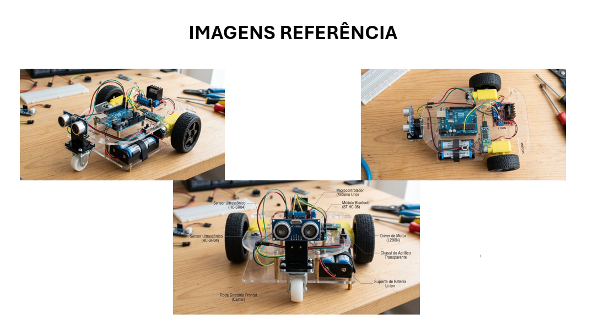

# RoboMaker — Carrinho robótico com ESP32, controle BLE e TinyML (Edge Impulse)

Projeto da disciplina de robótica. Um carrinho de 2 rodas, controlado pelo iPhone por Bluetooth Low Energy, que para diante de obstáculos usando um sensor ultrassônico. Na segunda etapa (**CP2**) o projeto evolui para **TinyML**: os dados do sensor são coletados pelo grupo, um modelo é treinado no **Edge Impulse** e roda dentro do ESP32 para classificar a situação à frente do carrinho.

**Integrantes:** Vinícius Bernardino · Gabriel Pacheco

> **Convenção deste README.** Tudo que está escrito como fato (hardware, pinagem, código, formato dos dados) existe no projeto. Os pontos que dependem de medições ou de telas do Edge Impulse estão marcados com **`[PREENCHER]`**. Eles só devem ser preenchidos com o que o grupo coletar e obtiver de verdade, e os prints devem ser reais. Números, matrizes de confusão e acurácias **não são inventados** aqui.

---

## Sumário

1. [Evolução CP1 → CP2](#1-evolução-cp1--cp2)
2. [Visão geral e arquitetura](#2-visão-geral-e-arquitetura)
3. [Hardware](#3-hardware)
4. [Estrutura do repositório](#4-estrutura-do-repositório)
5. [Firmware do ESP32](#5-firmware-do-esp32)
6. [Dataset e coleta de dados](#6-dataset-e-coleta-de-dados)
7. [Projeto no Edge Impulse](#7-projeto-no-edge-impulse)
8. [Integração do modelo com o ESP32](#8-integração-do-modelo-com-o-esp32)
9. [Como reproduzir](#9-como-reproduzir)
10. [Estado atual e problemas conhecidos](#10-estado-atual-e-problemas-conhecidos)
11. [Gestão do projeto (CP1)](#11-gestão-do-projeto-cp1)
12. [Referências](#12-referências)

---

## 1. Evolução CP1 → CP2

O histórico de commits mostra a evolução. Os arquivos do CP1 são **mantidos**, e o CP2 é acrescentado por cima, em novos commits.

### O que mudou de um checkpoint para o outro

| Aspecto | CP1 (planejamento) | CP2 (implementação + TinyML) |
|---|---|---|
| Microcontrolador | Arduino Uno | **ESP32 DevKit V1** |
| Comunicação | Módulo Bluetooth HC-05/HC-06 | **BLE nativo do ESP32** (app Bluefruit Connect, iPhone) |
| Alimentação | Bateria 7,4 V | 2× 18650 em série (7,4 V), 5 V para o ESP32 vindo do L298N |
| Montagem | Previa protoboard (imagens de referência) | **Sem protoboard**, tudo ligado direto com jumpers |
| Inteligência | Parada por limite de distância | Limite de distância **+ modelo TinyML** (Edge Impulse) |
| Entregas | Backlog, Kanban, MoSCoW, MVP, medidas, diagrama | Firmware, coleta de dados, dataset, projeto Edge Impulse, integração |

O motivo da troca Arduino Uno → ESP32: o Uno tem apenas 2 KB de RAM, o que inviabiliza rodar um modelo TinyML. O ESP32 tem BLE integrado e memória suficiente.

### Histórico de commits

**CP1** (já existentes, não alterados):

| Commit | Data | Conteúdo |
|---|---|---|
| `4ac0410` | 25/08/2026 | Initial commit |
| `0690792` | 25/08/2026 | Documentação inicial (upload) |
| `57b4584` | 27/08/2026 | Documentação (upload) |
| `d9768fb` | 31/08/2026 | Documentação (upload) |

**CP2** (a serem registrados à medida que cada etapa for feita, um commit por etapa, **sem sobrescrever o CP1**):

| Ordem | Mensagem sugerida do commit | O que entra |
|---|---|---|
| 1 | `CP2: firmware de teste dos motores e do sensor` | `firmware/01_teste_motores`, `03_teste_sensor` |
| 2 | `CP2: controle BLE e parada por obstáculo` | `firmware/02_carrinho_ble` |
| 3 | `CP2: firmware e script de coleta de dados` | `coleta/04_coleta_dados`, `coletar_csv.py` |
| 4 | `CP2: dataset coletado com o HC-SR04` | `dataset/*.csv`, `resumo_coleta.csv`, `relatorio_coleta.md` |
| 5 | `CP2: projeto Edge Impulse (impulse, treino e resultados)` | prints em `img/edge-impulse/`, métricas |
| 6 | `CP2: biblioteca Edge Impulse e inferência no ESP32` | `lib/` ou `.zip` da biblioteca, sketch de inferência |
| 7 | `CP2: integração do modelo com o carrinho e testes` | sketch final, resultados de teste |
| 8 | `CP2: README final` | este arquivo preenchido |

Exemplo de como registrar cada etapa (sempre `add` + `commit` + `push`, nunca `push --force`):

```bash
git add firmware/
git commit -m "CP2: firmware de teste dos motores e do sensor"
git push
```

---

## 2. Visão geral e arquitetura

Funcionalidades:

- Movimentos: frente, ré, esquerda, direita e parada.
- Controle pelo iPhone via BLE (Bluefruit Connect, aba *Controller → Control Pad*).
- Parada automática diante de obstáculo, com histerese (bloqueia a 20 cm e só libera a 25 cm).
- Ajuste de velocidade pelo app, com partida suave (rampa de PWM).
- **CP2:** classificação da situação à frente por um modelo TinyML rodando no ESP32, usada para decidir o movimento no modo automático.

Fluxo de dados completo:

```text
HC-SR04 ──► ESP32 ──► (modo coleta) ──► USB ──► coletar_csv.py ──► CSVs ──► Edge Impulse
                                                                              │
                                                                  treino + biblioteca (.zip)
                                                                              │
HC-SR04 ──► ESP32 ──► janela de leituras ──► modelo TinyML ──► classe ──► decisão ──► L298N ──► motores
                ▲
   iPhone (BLE) ┘  (controle manual tem prioridade sobre o modo automático)
```

Diagrama de blocos original do CP1 (Arduino Uno, antes da troca para ESP32):


---

## 3. Hardware

### Componentes

| Componente | Função |
|---|---|
| ESP32 DevKit V1 | Microcontrolador, BLE e inferência TinyML |
| Driver de motor L298N (ponte H) | Aciona os dois motores DC |
| Kit de chassi acrílico 2WD | 2 motores com caixa de redução, 2 rodas, roda boba |
| Sensor ultrassônico HC-SR04 | Mede a distância até o obstáculo |
| 2× bateria 18650 + suporte | Alimentação (7,4 V nominais) |
| Jumpers (F-F, M-F, M-M) | Todas as ligações, sem protoboard |

Dimensões usadas no planejamento do CP1:


### Pinagem do ESP32

| Sinal | Pino do ESP32 | Destino | Observação |
|---|---|---|---|
| ENA | GPIO 25 | L298N ENA | PWM, velocidade do motor esquerdo (capinha removida) |
| IN1 | GPIO 26 | L298N IN1 | Direção do motor esquerdo |
| IN2 | GPIO 27 | L298N IN2 | Direção do motor esquerdo |
| IN3 | GPIO 14 | L298N IN3 | Direção do motor direito (dá um pulso curto ao ligar) |
| IN4 | GPIO 13 | L298N IN4 | Direção do motor direito |
| ENB | GPIO 33 | L298N ENB | PWM, velocidade do motor direito (capinha removida) |
| TRIG | GPIO 18 | HC-SR04 TRIG | Disparo da medição |
| ECHO | GPIO 19 | HC-SR04 ECHO | Retorno do eco |
| LED | GPIO 2 | LED da placa | Indicador de estado |

### Alimentação

| De | Para |
|---|---|
| Bateria + (7 a 12 V) | L298N, borne **12V** |
| Bateria − | L298N, borne **GND** |
| L298N, borne **5V** | ESP32, pino **VIN** |
| L298N, borne **GND** | ESP32, pino **GND** (GND comum) |
| L298N OUT1 / OUT2 | Motor A (esquerdo no código) |
| L298N OUT3 / OUT4 | Motor B (direito no código) |
| HC-SR04 VCC / GND | ESP32 **3V3** / **GND** |

Cuidados:

- Os pinos do ESP32 trabalham em 3,3 V e **não toleram 5 V**. Por isso o HC-SR04 foi alimentado com 3,3 V (o ECHO pode ir direto ao GPIO). A alternativa é alimentar com 5 V e usar divisor de tensão (1 kΩ e 2 kΩ) no ECHO.
- Nunca ligar o cabo USB e a alimentação pelo pino VIN ao mesmo tempo.
- O jumper do 5V-EN do L298N foi mantido (o regulador do L298N gera os 5 V para o ESP32).

---

## 4. Estrutura do repositório

Estrutura-alvo do CP2. Os itens marcados com *(CP1)* já existem; o restante é acrescentado nos commits do CP2.

```text
RoboMaker/
├── README.md
├── Docum/                                   (CP1)
│   ├── # Backlog Robô Maker.md
│   ├── # Kanban Robô Maker.md
│   ├── MoSCoW.pdf
│   └── MVP Projeto Robô Maker.pdf
├── img/                                     (CP1: DiagramaBlocos, Medidas, Referencia)
│   └── edge-impulse/                        prints reais do Studio (CP2)
├── firmware/
│   ├── 01_teste_motores/01_teste_motores.ino
│   ├── 02_carrinho_ble/02_carrinho_ble.ino
│   ├── 03_teste_sensor/03_teste_sensor.ino
│   └── 05_diagnostico_motores/05_diagnostico_motores.ino
├── coleta/
│   ├── 04_coleta_dados/04_coleta_dados.ino
│   └── coletar_csv.py
├── dataset/
│   ├── <classe>.<NNN>.csv                   um arquivo por captura
│   ├── resumo_coleta.csv
│   └── relatorio_coleta.md
├── edge-impulse/
│   └── ei-robomaker-arduino-x.y.z.zip       biblioteca exportada do Studio
└── inferencia/
    └── 06_inferencia_ei/06_inferencia_ei.ino
```

> No Arduino IDE, cada `.ino` precisa estar numa pasta com o mesmo nome do arquivo.

---

## 5. Firmware do ESP32

| Arquivo | Para que serve | Estado |
|---|---|---|
| `01_teste_motores.ino` | Sequência de 8 passos (frente, ré, curvas, giros) com 2 s cada, para validar motores e fiação. Usa PWM nos pinos ENA/ENB. | Escrito |
| `02_carrinho_ble.ino` | Programa principal. Servidor BLE (Nordic UART) que entende o protocolo do Control Pad do Bluefruit Connect, controla os motores com rampa de velocidade e bloqueia o avanço diante de obstáculo. Tem modo automático básico. | Escrito |
| `03_teste_sensor.ino` | Lê o HC-SR04 e imprime a distância no Monitor Serial, para testar o sensor isolado. | Escrito |
| `04_coleta_dados.ino` | Lê o HC-SR04 a 10 Hz e imprime `timestamp,distancia_cm` pela USB. Mantém os motores parados. | Escrito e testado em simulação |
| `05_diagnostico_motores.ino` | Teste liga/desliga sem PWM, para separar problema de fiação de problema de código. | Escrito |
| `06_inferencia_ei.ino` | Inferência com a biblioteca do Edge Impulse e uso da classe no carrinho. | **A fazer** (ver [seção 8](#8-integração-do-modelo-com-o-esp32)) |

Detalhes do `02_carrinho_ble.ino`:

| Parâmetro | Valor |
|---|---|
| Nome BLE | `Carrinho-01` |
| Distância de parada | 20 cm |
| Distância de liberação | 25 cm |
| Velocidade inicial | 190 (de 0 a 255) |
| Velocidade mínima útil | 110 (abaixo disso o motor só zumbe, então o código trata como 0) |
| Fator de curva | 0,40 (a roda de dentro anda a 40% da de fora) |
| Velocidade no modo automático | 150 |
| Frequência do PWM | 5 kHz, 8 bits |

O código funciona com as versões 2.x e 3.x do núcleo *esp32 by Espressif*, que têm APIs de PWM diferentes.

---

## 6. Dataset e coleta de dados

### 6.1 Sensor utilizado

**HC-SR04**, sensor ultrassônico de distância.

| Característica | Valor |
|---|---|
| Alcance | cerca de 2 cm a 400 cm |
| Princípio | Pulso de 10 µs no TRIG; o ECHO fica em nível alto durante o tempo de ida e volta do som |
| Cálculo | `distância (cm) = tempo (µs) × 0,0343 / 2` |
| Ligação | TRIG → GPIO 18, ECHO → GPIO 19, VCC → 3V3, GND → GND |
| Espera máxima pelo eco | 25 ms (cerca de 4 m) |

O sensor foi emprestado e usado por tempo limitado. Por isso a coleta foi planejada para ser rápida e gravar tudo automaticamente.

### 6.2 Dados coletados

Uma série temporal de **distância em centímetros** em função do tempo.

| Coluna | Tipo | Descrição |
|---|---|---|
| `timestamp` | inteiro (ms) | Tempo desde o início da captura, com intervalo constante |
| `distancia_cm` | decimal | Distância medida pelo HC-SR04 |

- Frequência de amostragem: **10 Hz** (uma leitura a cada 100 ms).
- Quando nenhum eco volta (nada à frente, ou superfície que não reflete o som), o valor gravado é **400 cm**, o alcance máximo do sensor. Isso evita buracos nos dados.

### 6.3 Como a coleta foi realizada

A coleta é feita por dois programas que trabalham juntos:

1. `04_coleta_dados.ino`, gravado no ESP32, envia as leituras pela porta serial a 115200 baud.
2. `coletar_csv.py`, executado no computador (`pip install pyserial`), faz o resto:
   - detecta a porta do ESP32 sozinho (ou usa `--porta COMx`);
   - testa a conexão e avisa se todas as leituras forem 400 cm (sensor desligado ou mal ligado);
   - pergunta a classe, faz uma contagem regressiva de 3 s e captura 10 s;
   - confere o intervalo entre leituras e **descarta** a captura se houver pausa, reinício da placa ou poucas amostras;
   - grava `dataset/<classe>.<NNN>.csv`, com `timestamp` zerado no início;
   - aceita `Enter` (repetir a classe), `d` (apagar a última captura) e `q` (sair);
   - regenera `resumo_coleta.csv` e `relatorio_coleta.md` a partir dos arquivos que existem.

Procedimento de captura para cada classe (confirmar e ajustar com o que foi realmente feito):

| Classe | Como foi feita a captura |
|---|---|
| `livre` | Carrinho parado, sem nada à frente do sensor |
| `parado_perto` | Obstáculo fixo a curta distância do sensor |
| `aproximando` | Obstáculo (ou o carrinho) se aproximando devagar durante os 10 s |
| `afastando` | Obstáculo se afastando devagar durante os 10 s |

Recomendações para o dataset ficar útil: variar a distância inicial entre capturas, variar o tipo de obstáculo (caixa, mão, parede, livro) e variar a velocidade do movimento.

### 6.4 Classes definidas

| Classe | Significado | Uso no carrinho |
|---|---|---|
| `livre` | Caminho livre à frente | Seguir em frente |
| `parado_perto` | Obstáculo próximo e estático | Parar e desviar |
| `aproximando` | Distância diminuindo | Frear / reduzir velocidade |
| `afastando` | Distância aumentando | Seguir / liberar o avanço |

### 6.5 Arquivos CSV do projeto

Os arquivos ficam em `dataset/`, no formato aceito pelo Edge Impulse: o rótulo vem do nome do arquivo (`<classe>.<NNN>.csv`) e cada CSV é uma amostra.

Exemplo do formato de um arquivo (**ilustra apenas a estrutura**, não são dados reais):

```csv
timestamp,distancia_cm
0,<distância>
100,<distância>
200,<distância>
```

Arquivos gerados (**`[PREENCHER]`** com a lista real depois da coleta; o `relatorio_coleta.md` gerado pelo script já traz essa tabela):

| Arquivo | Classe | Amostras (linhas) | Duração |
|---|---|---|---|
| `[PREENCHER]` | | | |

### 6.6 Quantidade de amostras

Preencher com os valores gerados pelo script em `relatorio_coleta.md` e `resumo_coleta.csv`:

| Classe | Nº de capturas (arquivos) | Nº de medições | Duração total |
|---|---|---|---|
| livre | `[PREENCHER]` | `[PREENCHER]` | `[PREENCHER]` |
| parado_perto | `[PREENCHER]` | `[PREENCHER]` | `[PREENCHER]` |
| aproximando | `[PREENCHER]` | `[PREENCHER]` | `[PREENCHER]` |
| afastando | `[PREENCHER]` | `[PREENCHER]` | `[PREENCHER]` |
| **Total** | `[PREENCHER]` | `[PREENCHER]` | `[PREENCHER]` |

Meta de planejamento: cerca de 10 capturas de 10 s por classe (100 medições por captura). O número real é o que está na tabela acima.

Data e local da coleta: `[PREENCHER]`.

Evidência da coleta (foto do carrinho com o sensor, tela do `coletar_csv.py` gravando): `[PREENCHER: img/coleta_01.png]`.

---

## 7. Projeto no Edge Impulse

Projeto no Studio: `[PREENCHER: nome e link do projeto]`.

Cada item abaixo diz **o que fazer** e deixa o **registro real** para o grupo preencher, com o print correspondente em `img/edge-impulse/`.

### 7.1 Preparação e importação dos dados

1. Criar o projeto no Edge Impulse Studio.
2. *Data acquisition → Upload data*, selecionar todos os CSVs de `dataset/`.
3. Em *Label*, escolher **Infer from filename** (o rótulo sai do nome do arquivo).
4. Em *Upload into category*, escolher **Automatically split between training and testing**.
5. Se o Studio pedir, usar o *CSV Wizard* e indicar `timestamp` como coluna de tempo, `distancia_cm` como eixo e a frequência de 10 Hz.

Registro: `[PREENCHER: número de amostras importadas e print]` → `img/edge-impulse/01_dados.png`

### 7.2 Divisão dos dados

| Conjunto | Amostras | Proporção |
|---|---|---|
| Treinamento | `[PREENCHER]` | `[PREENCHER]` (o Studio sugere cerca de 80%) |
| Teste | `[PREENCHER]` | `[PREENCHER]` (cerca de 20%) |

Print: `img/edge-impulse/02_divisao.png`

### 7.3 Configuração do Impulse

| Bloco | Configuração | Valor usado |
|---|---|---|
| Time series data | Tamanho da janela | `[PREENCHER]` ms (sugestão inicial: 2000 ms, ou seja, 20 leituras) |
| | Deslocamento da janela | `[PREENCHER]` ms (sugestão: 500 ms) |
| | Frequência | 10 Hz |
| Processing block | Tipo | `[PREENCHER]` |
| Learning block | Tipo | `[PREENCHER]` |
| Saída | Classes | livre, parado_perto, aproximando, afastando |

Print: `img/edge-impulse/03_impulse.png`

### 7.4 Processamento

Com um único eixo (distância) e janelas curtas, o bloco *Spectral Analysis* (ou *Flatten*, que extrai média, mínimo, máximo e inclinação) tende a funcionar bem, porque as classes diferem pela **tendência** da distância (subindo, descendo ou constante) e pelo seu valor médio.

Bloco escolhido e justificativa: `[PREENCHER]`

Registro: parâmetros da extração de características, *Feature explorer* mostrando a separação das classes. Print: `img/edge-impulse/04_features.png`

### 7.5 Modelo escolhido e treinamento

| Item | Valor |
|---|---|
| Tipo de modelo | `[PREENCHER]` (ex.: rede neural densa com *Classification*) |
| Ciclos (epochs) | `[PREENCHER]` |
| Taxa de aprendizado | `[PREENCHER]` |
| Quantização | `[PREENCHER]` (int8 ou float32) |
| Justificativa | `[PREENCHER]` |

Print: `img/edge-impulse/05_treino.png`

### 7.6 Resultados e métricas

Copiar do Studio, depois do treino (*Validation set*) e de *Model testing* (*Test set*):

| Métrica | Treino/validação | Teste |
|---|---|---|
| Acurácia | `[PREENCHER]` | `[PREENCHER]` |
| Perda (loss) | `[PREENCHER]` | n/d |
| F1 por classe | `[PREENCHER]` | `[PREENCHER]` |

Matriz de confusão (colar a do Studio, não inventar):

| Real \ Previsto | livre | parado_perto | aproximando | afastando |
|---|---|---|---|---|
| livre | `[PREENCHER]` | | | |
| parado_perto | | `[PREENCHER]` | | |
| aproximando | | | `[PREENCHER]` | |
| afastando | | | | `[PREENCHER]` |

Uso de memória e tempo estimados pelo Studio para o ESP32: RAM `[PREENCHER]`, Flash `[PREENCHER]`, latência `[PREENCHER]`.

Análise: quais classes foram confundidas e por quê, o que foi feito para melhorar (mais dados, outra janela, outro bloco): `[PREENCHER]`

Prints: `img/edge-impulse/06_matriz.png`, `img/edge-impulse/07_teste.png`

### 7.7 Testes de inferência

- **No Studio** (*Live classification* e *Model testing*): `[PREENCHER: resultados e print]` → `img/edge-impulse/08_live.png`
- **No ESP32** (Monitor Serial mostrando a classe e a confiança de cada janela): `[PREENCHER: tabela de situações testadas]`

| Situação testada | Classe esperada | Classe obtida | Confiança |
|---|---|---|---|
| `[PREENCHER]` | | | |

Print: `img/edge-impulse/09_serial.png`

---

## 8. Integração do modelo com o ESP32

### 8.1 Biblioteca gerada pelo Edge Impulse

1. No Studio, *Deployment → Arduino library*, otimização *Quantized (int8)* ou *Unoptimized (float32)*, *Build*.
2. Salvar o `.zip` em `edge-impulse/` (commit próprio no repositório).
3. No Arduino IDE: *Sketch → Include Library → Add .ZIP Library…*

### 8.2 Inferência no microcontrolador

O sketch de inferência (`06_inferencia_ei.ino`) segue o padrão da biblioteca do Edge Impulse:

1. A cada 100 ms, lê o HC-SR04 e guarda o valor num buffer circular com o tamanho da janela do impulse (`EI_CLASSIFIER_RAW_SAMPLE_COUNT`).
2. Quando o buffer está cheio, monta um `signal_t` com `numpy::signal_from_buffer(...)`.
3. Chama `run_classifier(&signal, &resultado, false)`.
4. Escolhe a classe de maior confiança em `resultado.classification[i].value`.
5. Só aceita a classe se a confiança passar de um limite (ex.: 0,7). Caso contrário, mantém a decisão anterior.

O nome do arquivo de cabeçalho (`#include <NOME_DO_PROJETO_inferencing.h>`) depende do nome do projeto no Studio: `[PREENCHER]`.

### 8.3 Uso da saída do modelo no programa do carrinho

A classe prevista é convertida numa ação do carrinho, aproveitando as funções de movimento e a parada por obstáculo que já existem em `02_carrinho_ble.ino`:

| Classe prevista | Ação do carrinho |
|---|---|
| `livre` | Avançar (velocidade do modo automático) |
| `aproximando` | Reduzir a velocidade |
| `parado_perto` | Parar e girar para procurar caminho livre |
| `afastando` | Avançar |

Regras de segurança (a manter): o limite de 20 cm do sensor continua bloqueando o avanço **independentemente do modelo**, e o comando manual pelo iPhone deve ter prioridade sobre o modo automático.

Estado: `[PREENCHER: integrado e testado / parcialmente integrado / não concluído]`

---

## 9. Como reproduzir

### 9.1 Pré-requisitos

- Arduino IDE com o núcleo **esp32 by Espressif** (versão 2.x ou 3.x).
- Placa: **ESP32 Dev Module**. Driver **CP210x** instalado no Windows para a porta COM aparecer.
- Python 3 e `pip install pyserial` (para a coleta).
- App **Bluefruit Connect** no iPhone.

### 9.2 Testar a montagem

1. Gravar `03_teste_sensor.ino` e conferir as distâncias no Monitor Serial (115200).
2. Gravar `01_teste_motores.ino` com o carrinho levantado (rodas sem tocar a mesa). Se os motores só chiarem, usar `05_diagnostico_motores.ino` (ver [seção 10](#10-estado-atual-e-problemas-conhecidos)).

### 9.3 Controlar pelo iPhone

1. Gravar `02_carrinho_ble.ino`.
2. No Bluefruit Connect, conectar em `Carrinho-01`, abrir *Controller → Control Pad*.
3. Setas movem o carrinho; botões 2 e 3 ajustam a velocidade.

### 9.4 Coletar dados

1. Gravar `04_coleta_dados.ino`, **fechar o Monitor Serial**.
2. `python coletar_csv.py` (na pasta onde `dataset/` deve ser criada).
3. Seguir as perguntas do programa, classe por classe.

### 9.5 Treinar no Edge Impulse e rodar no ESP32

Seguir as seções 7 e 8.

---

## 10. Estado atual e problemas conhecidos

| Item | Estado |
|---|---|
| Chassi, ligações e alimentação montados (sem protoboard) | Concluído |
| Firmware de teste dos motores, do sensor e controle BLE | Escrito |
| Conexão e gravação no ESP32 pela USB | Funcionando (driver CP210x instalado) |
| Programa de coleta e script do computador | Escritos e testados em simulação |
| **Movimento dos motores** | **Com problema: os motores apenas chiam e não giram** |
| Coleta real de dados com o HC-SR04 | `[PREENCHER]` |
| Treinamento no Edge Impulse | `[PREENCHER]` |
| Inferência no ESP32 e integração | `[PREENCHER]` |

**Problema dos motores.** Ao rodar o teste de motores, ouve-se um chiado e as rodas não giram, embora os motores funcionem ligados direto nas baterias. Com as capinhas (jumpers) recolocadas em ENA/ENB, o chiado some, mas o motor continua parado. Isso indica que o L298N não está recebendo sentido de giro nos pinos IN, ou que há problema de energia ou de contato. Investigação planejada:

1. Ligar IN1 no 5V e IN2 no GND do L298N, direto, sem o ESP32 (com as capinhas em ENA/ENB).
2. Medir a tensão entre 12V e GND do L298N (esperado: 7 V ou mais) e entre OUT1 e OUT2.
3. Conferir os parafusos dos bornes e o suporte de baterias.
4. Rodar `05_diagnostico_motores.ino`.

Resultado da investigação: `[PREENCHER]`

---

## 11. Gestão do projeto (CP1)

Documentos do planejamento, em `Docum/`:

| Documento | Conteúdo |
|---|---|
| [`# Backlog Robô Maker.md`](Docum/%23%20Backlog%20Rob%C3%B4%20Maker.md) | 18 tarefas (T01 a T18) com responsável, prioridade, dependência e critério de aceite |
| [`# Kanban Robô Maker.md`](Docum/%23%20Kanban%20Rob%C3%B4%20Maker.md) | Quadro com o andamento (Backlog, A fazer, Em andamento, Em teste, Em correção, Concluído) |
| [`MoSCoW.pdf`](Docum/MoSCoW.pdf) | Funcionalidades essenciais e não essenciais |
| [`MVP Projeto Robô Maker.pdf`](Docum/MVP%20Projeto%20Rob%C3%B4%20Maker.pdf) | Definição do MVP: 4 direções, controle por Bluetooth, detecção e parada diante de obstáculos |

Divisão de trabalho:

| Integrante | Foco |
|---|---|
| Gabriel Pacheco | Montagem do chassi, fixação dos componentes, circuito de alimentação |
| Vinícius Bernardino | Programação dos movimentos, sensor, controle Bluetooth, fail-safe |
| Ambos | Ligação dos motores, sensor e Bluetooth, testes integrados, documentação |

Imagens usadas como referência de montagem no CP1:



Nota: as tarefas do Backlog que citam Arduino Uno e HC-05/HC-06 foram adaptadas no CP2 para ESP32 com BLE (ver [seção 1](#1-evolução-cp1--cp2)). O critério de aceite de cada tarefa permanece o mesmo.

---

## 12. Referências

- [Documentação do Edge Impulse: formato de CSV e upload de dados](https://docs.edgeimpulse.com/docs/edge-impulse-studio/data-acquisition)
- [Edge Impulse: implantação como biblioteca Arduino](https://docs.edgeimpulse.com/docs/run-inference/arduino-library)
- [Núcleo Arduino para ESP32 (Espressif)](https://docs.espressif.com/projects/arduino-esp32/en/latest/)
- [Adafruit Bluefruit LE Connect (app)](https://learn.adafruit.com/bluefruit-le-connect)
- Datasheet do sensor HC-SR04 e do driver L298N
